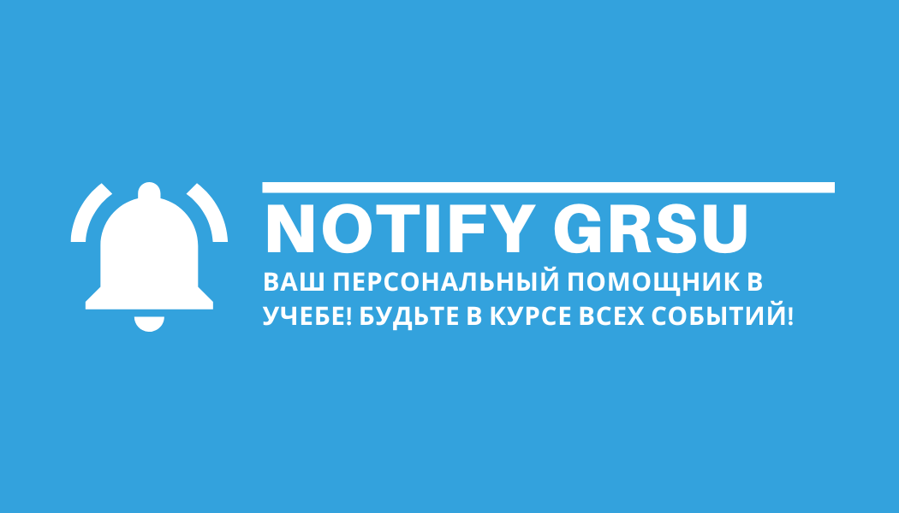
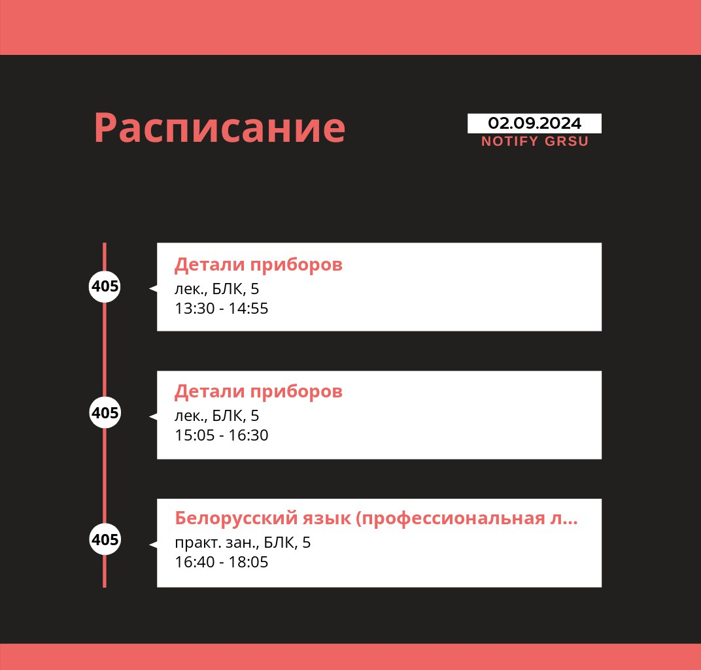

# ⚠️ Внимание! ⚠️
Проект находится в разработке, это не конечная версия! Пожалуйста, относитесь с пониманием, т.к я разрабатываю его один в свободное время.

# Notify GRSU

Надоело бесконечно заходить на сайт, только чтобы проверить, не поставили ли вам оценку?! Или может сайт не работает, а расписание вы не знаете?
Notify GRSU призван исправить эту проблему! Мы используем мессенджер **Telegram** и аккаунт бота, чтобы отправлять вам уведомления!

---

# Особенности:
- Просмотр основных разделов сайта
- Получение разного рода уведомлений:
  - Изменение расписания
  - Получение новых оценок
  - Пропуски
  - Промежуточная аттестация
  - Экзамены
- Удобный вывод расписания в виде изображения
- Множество настроек
- Работа при медленном интернете/частичная при отсутствии(кэш Telegram)
- Бесплатно
- Выбор способа логина: телефон/логин и пароль от образовательного портала
- Не требуется установка
- Открытый исходный код
- "Микро-API": модуль grsu

# Пример расписания:

# Локальный хостинг:
1. Скачайте исходный код проекта
2. Создайте и активируйте виртуальное окружение: python -m venv grsu-env
3. Активируйте виртуальное окружение(Для Windows и Linux разные способы, поэтому я не буду здесь писать)
4. Находясь в директории проекта сделайте pip install -r requirements.txt
5. Создайте файл .env
6. Добавьте в файл строку API_KEY=ВАШ_ТОКЕН, где ВАШ_ТОКЕН - токен вашего телеграмм бота. Чтобы получить его, перейдите к Bot Father в telegram
7. При включённом виртуальном окружении напишите в консоли python main.py.
**Тестирование работоспособности проводилось на версии python 3.10.6 и не гарантируется на других версиях!**

### To-Do Лист:
- [x] - Логин в систему
- [ ] Отправка уведомлений
    - [x] Уведомления об изменении расписания
    - [ ] Уведомления о новых оценках
    - [ ] Уведомления о пропусках
    - [ ] Уведомления об УСР
    - [ ] Уведомления о промежуточной аттестации / экзаменов
- [ ] Настройки (**65%**. Готова база для настроек. Осталось сделать сами настройки)
- [ ] Добавление домашних заданий(*Обдумывание*)
- [ ] Добавление заметок
- [x] Распределить скрипт по файлам
- [x] Переработать /info команду для более удобного использования
- [x] Переработать расписание(*Требуется тестирование*)
    - Возможно сделать отправку сообщения о расписании не текстом, а картинкой
    - Возможно переделать "планировщика" события. Вместо асинхронного сделать через потоки, потому что программа как будто блокируется

---

### Roadmap(что возможно планируется):
- PREMIUM план? Он позволит поддержать разработку(+хост бота), а также добавит функции:
    - Увеличение лимитов на загрузку дз и скачивания
    - Более высокий приоритет в очереди на получении уведомлений
    - Краткий пересказ презентаций лекций? Бот позволит вместо простого скачивания лекций сделать их пересказ(даже если там есть картинки текста, формул) с помощью GPT
- Сводка событий. Вместо того чтобы каждый раз отправлять уведомления о любом событии, отправлять одно в конце дня.
- "Что будет завтра?". В конце дня показывать какие занятия завтра, возможно важные события
- Интеграция для старост? Позволять студентам уведомлять старост что их завтра не будет с помощью команды. Может как-то ещё это реализовать по-другому. Сомнительно
